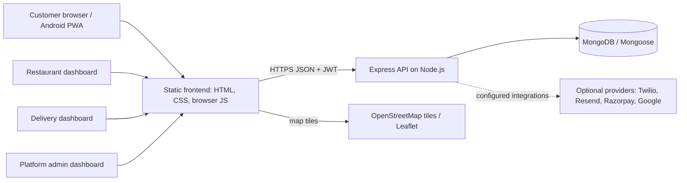
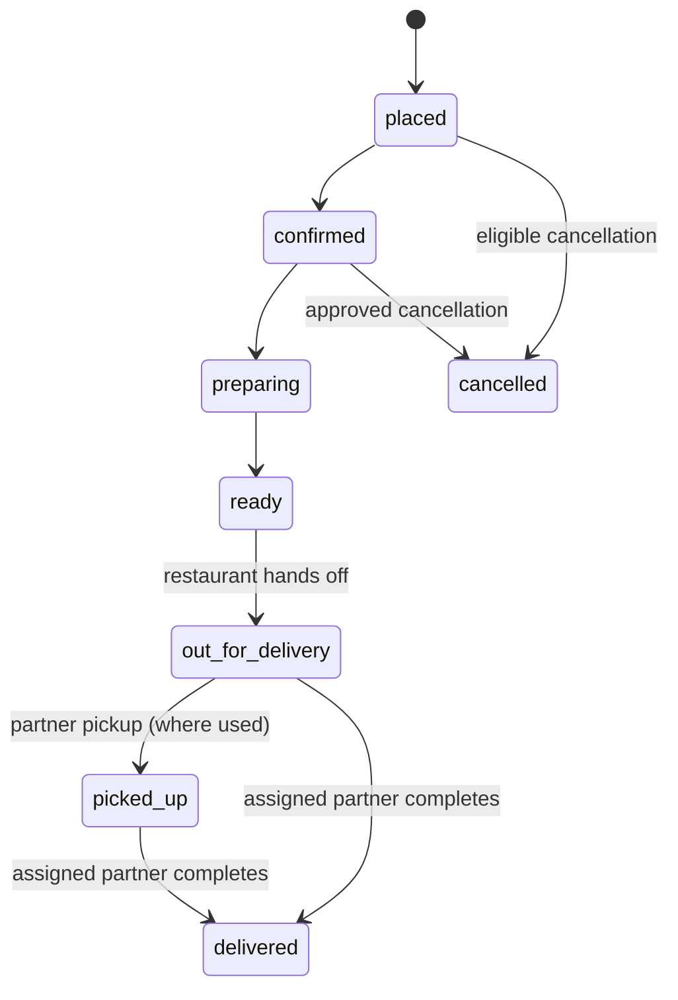

# Food Platform Architecture

**Status:** Architecture of the current MVP  
**Last updated:** 2026-10-19

## 1. System overview

The product has a static browser frontend, an Express API, and MongoDB persistence. The public customer website and Android Progressive Web App are branded for Sunrise Tiffin House and expose only its approved restaurant profile and menu. The platform-admin workspace remains separate for provisioning and managing the Sunrise owner account. The website and PWA use the same API and records. External integrations are optional and activated with server-side environment variables.

## 2. Repository and runtime layout

- `frontend/` contains role-specific static pages and browser JavaScript for customer, restaurant, delivery, and platform-admin experiences, plus the PWA manifest, service worker, and assets.
- `backend/src/app.js` creates the Express application and mounts auth, restaurant, order, review, admin, customer, and notification routes under `/api`.
- `backend/src/controllers/` contains request handlers; `routes/` maps HTTP paths to handlers; `middleware/` provides authentication, authorization, validation/error handling, and rate limiting; `models/` contains Mongoose schemas; `config/` contains database setup; `utils/` contains shared service logic.
- `backend/src/server.js` starts the local Node server. The app module can also be loaded as a serverless handler; database connection is ensured in the API request path.
- `backend/.env.example` documents configuration names. Real credentials belong only in the backend runtime environment, never in the frontend or repository.

## 3. Request lifecycle

1. A browser page calls the API over HTTPS using the shared frontend API helpers. Authenticated requests carry a bearer JWT; short-lived session tokens are stored in browser session storage.
2. Express applies security headers, allowlisted CORS, JSON parsing with a size limit and raw-body retention, and the general API rate limit.
3. Before API routes run, the backend checks that `JWT_SECRET` is sufficiently long and ensures MongoDB is connected.
4. Route middleware authenticates the token and enforces role, restaurant ownership, order assignment, and action-specific permissions.
5. Controllers validate inputs and business rules, read/write Mongoose documents, and return JSON. Public restaurant listing, profile, menu, review, and customer order creation are restricted to the approved Sunrise Tiffin House record; platform-admin account management remains a separate protected surface. The common error middleware formats failures; unknown routes return a JSON 404.

The configured CORS allowlist includes the configured frontend origins and the secure Android WebView asset origin. `trust proxy` is configured for one hosting proxy hop.

### Template and injection posture

The backend is an API-only Express application: it has no configured server-side view engine, no `res.render` routes, and no template-engine dependency. It returns JSON to a static frontend. Keep it that way unless server-rendered pages become an explicit requirement; never compile template source from request or database values. In the browser, use `textContent`/DOM methods for untrusted values. Existing HTML composition uses the shared `escapeHtml` helper, which escapes HTML metacharacters and both quote characters; keep dynamic values out of script, style, event-handler, and unvalidated URL contexts.

Backend validation uses fixed, simple regexes for bounded formats such as IDs, PIN codes, phone numbers, and times. Do not construct patterns from request values. Keep string/body limits in place, and reject incorrect fixed-format lengths before performing additional work.

## 4. Main data model

| Model | Responsibility and relationships |
| --- | --- |
| `User` | Customer, restaurant owner/staff, delivery partner, or platform-admin identity; stores role and account data. |
| `Restaurant` | Sunrise storefront, owner association, approval/open state, food type, service hours, named delivery areas with PIN-code coverage, and estimate settings. |
| `MenuItem` | Restaurant-owned dish, category, price, food type, image, and availability. |
| `Order` | Customer and restaurant references, item/price snapshots, delivery details, lifecycle and status history, assignment and GPS data, payment state, help/cancellation requests. |
| `Delivery` | Delivery-related records and workflow data where represented by the delivery model. |
| `Payment` | Payment provider/event state where payment integration is used. |
| `Notification` | In-app updates associated with relevant users and orders. |
| `Review` | Customer rating/comment associated with a restaurant/order. |
| `Subscription` | Subscription/billing domain model. |

Order prices are snapshotted in paise at order creation. The order separately stores payment method/status, collection time, and receipt time. GPS coordinates and timestamps are held on the order for the active delivery workflow and are subject to access controls and lifecycle cleanup.

## 5. Identity, roles, and permissions

- Authentication uses bcrypt password hashes and signed JWT access tokens. Phone OTP, Google sign-in, and optional email/SMS providers depend on configuration.
- User roles separate customers, restaurant users, delivery partners, and platform admins.
- Restaurant staff belong to a restaurant and have one of three additional roles: `secondary_admin`, `biller_modifier`, or `viewer`. The restaurant primary admin manages those staff accounts.
- API authorization is the source of truth. A UI link or hidden control does not grant access.
- Sensitive order/location actions are scoped to the customer, restaurant, or assigned delivery partner as appropriate. Only the assigned partner can complete delivery; customer coordinates are shared only for the active order and cleared on completion by the implemented workflow.
- The initial platform admin is provisioned through a controlled one-time process; no public admin signup route exists.

## 6. Order and delivery flow

At checkout, the backend verifies the restaurant, current menu availability and price, service settings, and delivery information before persisting the order. Assignment offers are presented in the delivery dashboard; a partner can accept or decline. The assignment process can offer the order to another active partner after a decline. Restaurant staff progress preparation and handoff. The assigned delivery partner records completion and cash collection for cash-on-delivery orders.

Order status history and database notifications provide a durable record of progress. Customer and restaurant screens refresh order state periodically. The application does not currently use websocket push for status or location updates.

## 7. Payment behavior

Checkout supports cash on delivery plus online and UPI selections recorded as customer preferences. It does not currently initiate an online charge or generate a UPI QR code. Preliminary Razorpay controller code exists, but there are no mounted payment routes and the customer checkout does not invoke it; therefore Razorpay is not an available payment flow, regardless of credentials. Cash collection is recorded at delivery completion. Refund and settlement operations still require provider-side and operational procedures.

No card number or CVV is stored by this application. Payment credentials must remain with the provider and backend secrets must never be shipped to browser code.

## 8. Live location and maps

The customer and delivery dashboards request browser GPS permission only when the user starts sharing. Location coordinates are sent to authenticated API endpoints with order-scoped authorization. Leaflet displays map tiles from OpenStreetMap. The frontend periodically refreshes location data; accuracy and freshness depend on device permissions, network connectivity, and the polling interval. Maps provide visual location context and external map links, not turn-by-turn navigation.

Location sharing requires a secure context (HTTPS or localhost). Access should remain limited to the customer and assigned partner, and location should be removed or made unavailable after delivery as implemented by the order workflow.

## 9. Notifications and integrations

- In-app notifications are persisted in MongoDB and read by customer/restaurant screens.
- Resend email, Twilio SMS/Verify, Google authentication, and payment provider features are optional integrations controlled by environment configuration.
- A missing provider configuration means the related external action is unavailable; credentials and integration failures should not be exposed to the browser.
- The PWA service worker uses network-first behavior and does not cache API responses. Offline functionality is limited to the cached static shell/home experience.

## 10. Deployment and configuration

- Deploy the static frontend as HTTPS content. Its customer surface is the Sunrise Tiffin House storefront; do not expose a restaurant directory or fall back to another restaurant's data.
- Run the Express backend on Node.js 20+ with MongoDB connectivity. The app can run as a long-lived Node server or through a compatible serverless adapter.
- Configure `MONGODB_URI`, a high-entropy `JWT_SECRET` of at least 32 characters, and exact allowed `FRONTEND_ORIGIN` values. Add optional provider secrets only when those features are intentionally enabled.
- Keep production secrets in the hosting platform's secret manager. Do not commit `.env` files, production tokens, or user data.
- The Android PWA must use the same HTTPS frontend and backend origins to share current data and account sessions across platforms.

## 11. Operational and security considerations

- Maintain least-privilege route checks for restaurant staff, delivery partners, and location data.
- Use HTTPS in production and keep CORS origins explicit.
- Keep provider keys server-side, rotate exposed credentials, and provision the first admin through a controlled process.
- Monitor API and database health, delivery assignment failures, payment callback failures, and outbound notification failures.
- Add automated tests for authentication, role boundaries, pricing, order-state transitions, delivery assignment, location privacy, and payment callbacks before production launch.
- Establish backups, retention/deletion rules for personal and location data, audit logging, incident response, and provider-specific refund/settlement procedures.

## 12. Known architecture limits

- The frontend is static browser JavaScript rather than a component framework; there is no dedicated mobile native client. Platform account records may be managed separately, but customer-facing restaurant APIs are Sunrise-only.
- Order and location updates use polling, not websocket or push transport.
- Online payment is not integrated into checkout; preliminary Razorpay controller code is not routed or called. UPI QR generation is not implemented. Tax/delivery charges default to zero unless separately configured.
- The repository is a starter MVP. Production launch requires deployment-specific review of scale, monitoring, privacy, payment operations, and security controls.

## Related documents

- [Product requirements](prd.md)
- [Implementation roadmap](docs/IMPLEMENTATION_ROADMAP.md)
